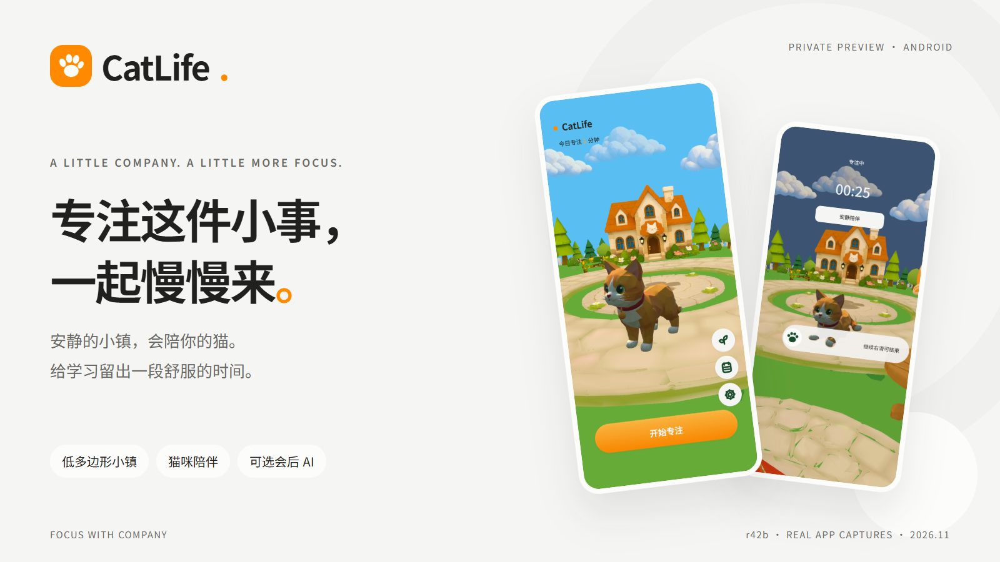
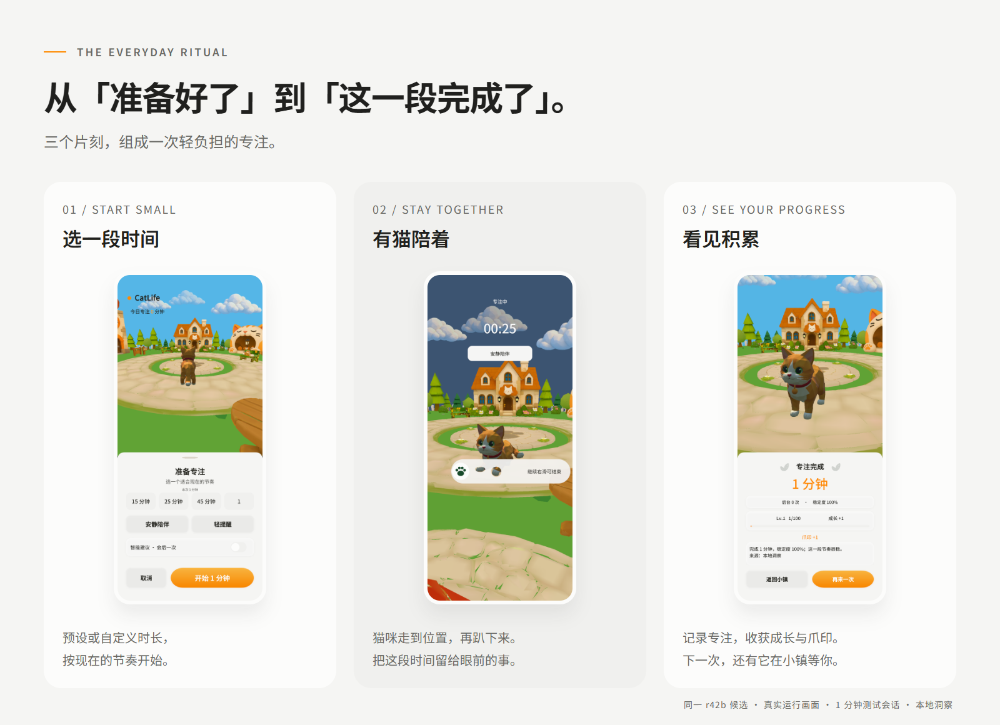
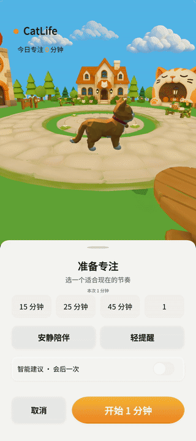
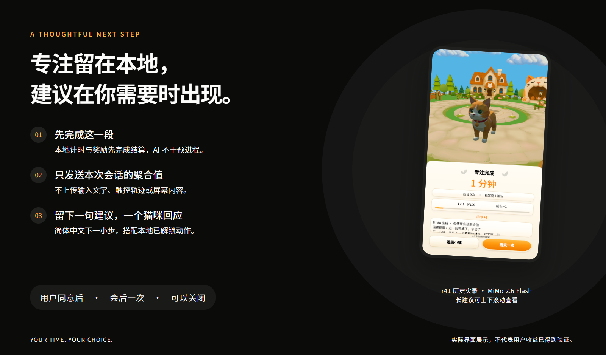

**一个有猫陪伴的专注小镇。**

低多边形场景、会走动和休息的猫咪，以及一段属于自己的时间。

[体验一段专注](#体验一段专注) · [了解可选 AI](#可选-ai) · [查看工程](#工程与验证) · [当前进展](docs/STATUS.md)

Android · Unity 6 · Blender · MiMo · 私有验证原型

## 体验一段专注

普通计时器记录时间。CatLife 想让开始这段时间的过程，多一点亲近感：打开小镇、选好节奏，猫咪走到位置，再趴下来陪你。

- **按自己的节奏开始。** 15、25、45 分钟预设，或 1–180 分钟自定义；安静陪伴与轻提醒可选。
- **让猫参与这段时间。** 到位、趴卧、起身和反馈动作连成过程；提前结束时，猫咪会温和挽留，你仍可继续滑动并确认退出。
- **把每一段积累留下。** 专注记录、七日统计、成长和爪印保存在本机，逐步解锁更多猫咪反应。

### 看它走到位置，趴下来陪你。

准备完成后，猫咪走向专注位置，动作过渡结束才开始倒计时。后台切换、进程重启后，应用按原截止时刻恢复会话；自然完成收获成长与爪印，中断不会获得奖励。

 
r42b 原片第 2 秒起约 22 秒 · 保留真实动作与界面 · 1 分钟为测试会话

## 可选 AI

AI 在你同意并开启后，于完成会话时请求一次。它提供一句温和提醒、一个具体的下一小步，以及猫咪回应的理由；本地系统将建议映射为已解锁的动作。

**本地计时与奖励独立运行 · 只发送本次聚合值 · 来源明确 · 失败不自动重试**

当前接入 `mimo-v2.6-flash`。r41 的一次真实会后请求返回 HTTP 200，实际呈现建议及“侧身轻摆尾 → 回站立”；冷启后保留结果与请求次数。AI 相对本地模板的收益仍待真人对照评价。

本页主页、流程和动态图已更新为 r42b；本轮离线结果显示“本地洞察”，未请求模型。上方 AI 画面保留 r41 历史实录，来源与新样式候选分别标注。

## 工程与验证

CatLife 起源于中国高校计算机大赛 AIGC 创新赛，现按实习私有交付范围维护。产品画面、动作资源与客户端代码均有对应的实现和验收记录。

| 一个完整的小镇 | 一套动作与会话控制 | 一条可解释的 AI 边界 |
|---|---|---|
| 完整空岛，229,286 三角面、16 材质、167 稳定资产 ID | 单一会话状态源、导航与动作仲裁、uGUI 页面和本地恢复 | 会后单次请求、输出约束、已解锁动作映射、明确反馈来源 |

| r42b 私有候选 | 本轮 UI 与手势 | APK 静态检查 |
|:---:|:---:|:---:|
| **83.54 MiB** | **G1 / G2 通过** | **6 / 6** |
| Android ARM64 · 0.3.0 (3) | 中性色、输入避让、字显与可见弹簧 | 权限与构建身份检查 |

r42b 已实测普通入口离线结算、后台与进程恢复、中断零奖励、关闭统计及真实软键盘输入。本轮 UI 样式和文字显现已由本人接受；30/60/120 秒自动专注与真实 AI 请求保留 r41 对应证据。以上是模拟器验证，4GB 真机与公开发行继续暂缓。[完整结果与尚待验收项 →](docs/STATUS.md)

<strong>阅读源码、准备工程与核对证据</strong>

| 入口 | 内容 |
|---|---|
| [Unity 工程](work/CatLife_Unity_Main) | Unity 6000.4.9f1 / C# / Android ARM64 / uGUI |
| [会话与本地规则](work/CatLife_Unity_Main/Assets/MobileRuntime/Core) | 计时、记录、奖励和派生统计 |
| [页面与动作协调](work/CatLife_Unity_Main/Assets/Scripts/Mobile) | UI、摄像机、猫咪表现和交互 |
| [开发与资产准备](docs/DEVELOPMENT.md) | 环境、运行资产准备和构建入口 |
| [实际修复与验证](docs/audits/2026-11-05-repair-results.md) | 问题根因、测试、独立候选与连续画面 |
| [r42 / r42b 样式验收](docs/development/2026-11-07-r42-android-acceptance.md) | 首包失败、键盘与绘制修复、真实同包验收 |
| [文档导航](docs/README.md) | 设计、资产规范和历史记录 |

猫和小镇素材来自 Meshy AI，运行资产包仅作私有实习交付。公开仓库提供代码、文档及展示画面；克隆后需要补齐运行资产才能完整构建。含本地凭据的验收 APK 不公开分发。

**给专注一点陪伴。**

[阅读开发文档](docs/DEVELOPMENT.md) · [反馈问题](https://github.com/JunyeFu/CatLife/issues) · [查看素材来源](docs/showcase/README.md)

展示更新 2026-11-07 · 主流程来自 r42b 实际运行 · AI 保留 r41 历史实录

