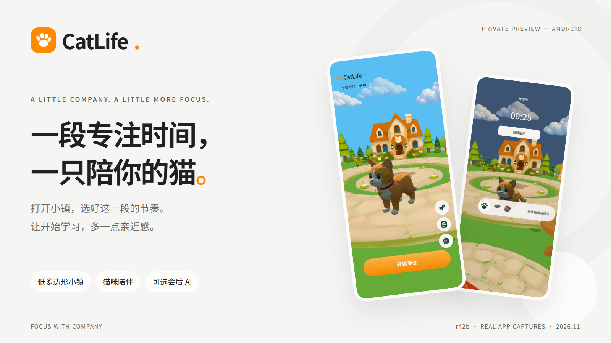
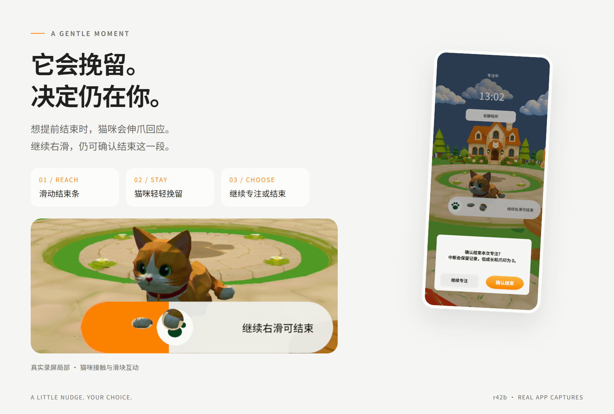
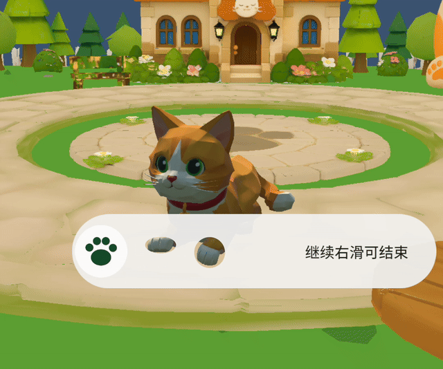
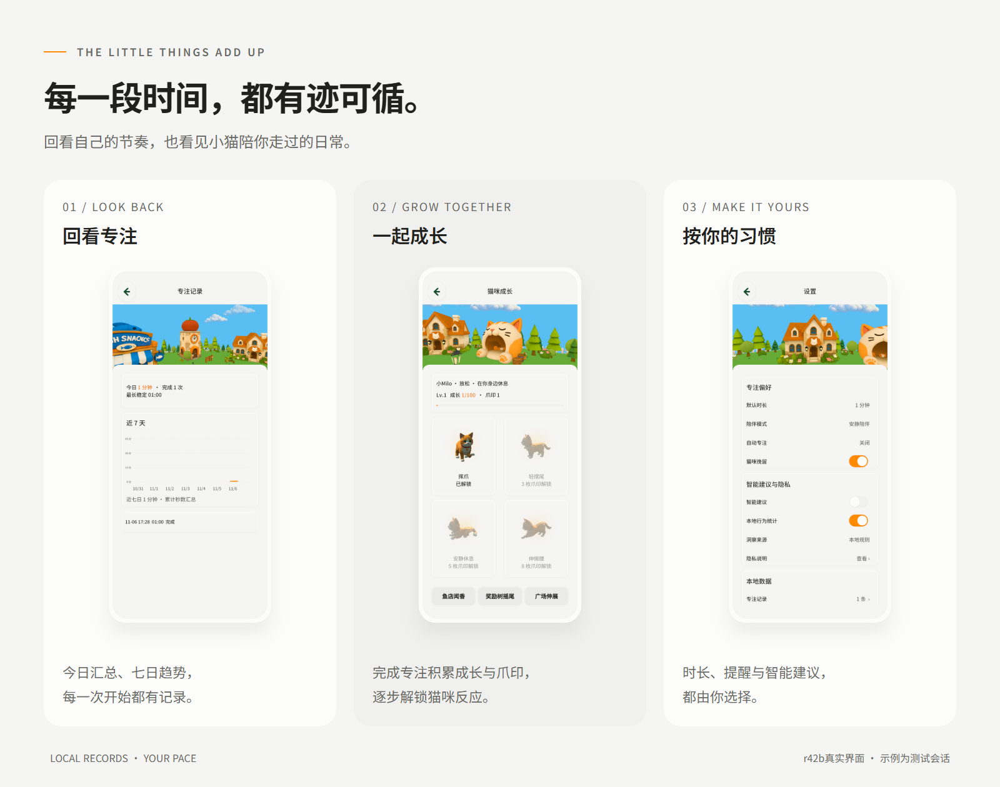

### 打开小镇，让专注有一点陪伴。

选一段时间，猫咪走到身边，趴下来陪你。 
在低多边形的小镇里，把这一段时间留给眼前的事。

[看使用过程](#从开始到完成都有它在) · [看猫咪挽留](#它会挽留决定仍在你) · [浏览日常界面](#每一段时间都有迹可循) · [打开工程](#工程与当前版本)

Android · 3D 猫咪陪伴 · 本地专注记录 · 可选会后 AI

## 从开始到完成，都有它在

用 15、25、45 分钟预设，或 1–180 分钟自定义时长，选好当下的节奏。猫咪会走到专注位置，趴卧过渡完成后才开始倒计时；自然完成后再起身，陪你收下这一段的成长与爪印。

 
真实连续录屏 · 一分钟为测试时长 · 非概念动画

## 它会挽留，决定仍在你

想提前结束时，猫咪会通过动作回应你的滑动。你可以继续专注，也可以继续右滑并确认结束；中断会留下记录，成长和爪印为零。

 
猫爪与结束条的真实互动 · 原片局部裁切

## 每一段时间，都有迹可循

记录页回看今日与近七日的专注；成长页查看等级、爪印和已解锁动作；设置页调整时长、提醒、猫咪挽留与智能建议。计时、记录和奖励保存在本机，关闭行为统计也能继续使用核心流程。

## 一句建议，留给下一小步

会后 AI 可以由你选择开启。取得同意后，应用只发送本次会话的时长、触控次数、后台次数和稳定度等聚合值，生成温和提醒与下一步建议，并映射为本地已解锁的猫咪回应。

**同意后才请求 · 会后一次 · 不上传输入文字、轨迹或屏幕 · 不改变计时和奖励**

新版 r42b 流程图展示离线「本地洞察」；上方 AI 结果保留 r41 的真实 mimo-v2.6-flash 实录，来源分别标注。[查看真实验证与当前进展 →](docs/STATUS.md)

## 工程与当前版本

CatLife 起源于中国高校计算机大赛 AIGC 创新赛，目前是用于私有实习交付的 Unity Android 原型。本页七个主要页面均来自已确认的 r42b 新前端；保留完整空岛、小镇贴图和既有猫咪动作。

**83.54 MiB 私有候选 · 双画幅七页核读 · 模拟器会话恢复与中断验证**

本地专注可离线完成；后台或进程重启后按原截止时刻恢复。新 UI 已完成真实键盘、逐字显现、结束条与至少十分钟运行观察，实际视觉已获项目所有者确认。[验收记录 →](docs/development/2026-11-07-r42-android-acceptance.md)

<strong>源码、技术结构与验证详情</strong>

| 入口 | 内容 |
|---|---|
| [Unity 工程](work/CatLife_Unity_Main) | Unity 6000.4.9f1 / C# / Android ARM64 / uGUI |
| [会话与本地规则](work/CatLife_Unity_Main/Assets/MobileRuntime/Core) | 唯一会话状态源、计时、奖励、记录和派生统计 |
| [页面与猫咪协调](work/CatLife_Unity_Main/Assets/Scripts/Mobile) | UI、镜头、导航、动作仲裁及会后建议展示 |
| [开发与资产准备](docs/DEVELOPMENT.md) | 依赖、运行资产准备、构建与私有配置入口 |
| [新版 UI 与 GitHub 交付](docs/development/2026-11-07-ui-style-delivery.md) | 设计规范、双画幅实测和展示来源 |
| [当前状态及已知问题](docs/STATUS.md) | 模拟器验证、历史 AI 证据与尚待完成项 |
| [文档导航](docs/README.md) | 设计、实现、资产规范与修复记录 |

完整小镇保持 229,286 三角面、16 材质、167 个稳定资产 ID。r42b APK 静态检查 6/6；相关 Unity 回归与实际读片范围分别记录，不合并为一次全量测试结论。

**当前交付边界：** 冷启仍可能有白屏等待；4GB 真机、真实用户收益评价与公开发行尚未完成。猫和小镇素材来自 Meshy AI，运行资产仅用于私有实习交付；公开仓库提供源码、文档和展示，克隆后需补齐运行资产才能完整构建。APK、运行模型包与私有配置不公开分发。

**一段时间，一点陪伴。**

[浏览源码](work/CatLife_Unity_Main) · [阅读开发文档](docs/DEVELOPMENT.md) · [反馈问题](https://github.com/JunyeFu/CatLife/issues) · [画面来源](docs/showcase/README.md)

展示更新 2026-11-07 · 新前端 r42b 实录 · AI 画面保留 r41 历史版本

