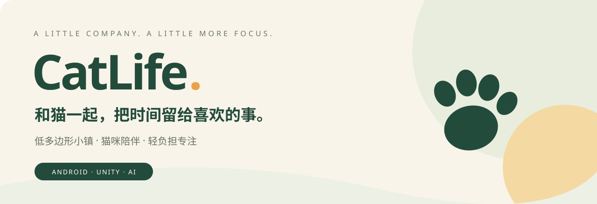
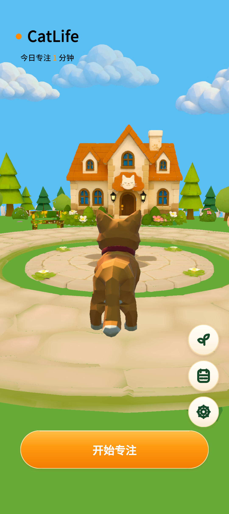
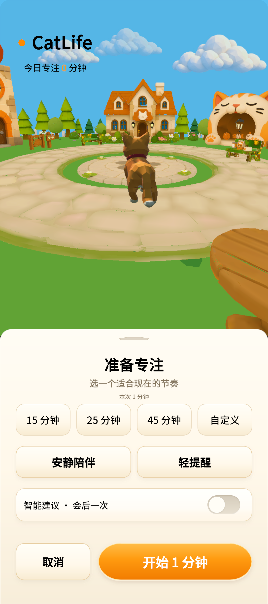
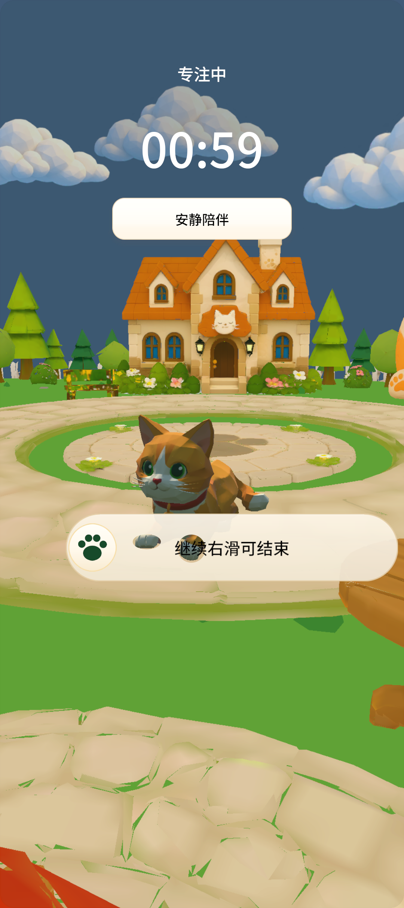
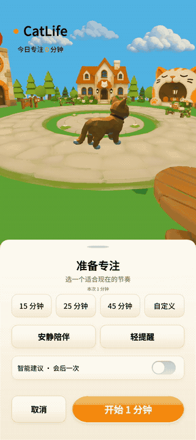

**一个有猫陪伴的专注小镇。让开始学习，多一点期待。**

[看真实画面](#真实画面) · [了解体验](#陪伴如何发生) · [查看当前进展](docs/STATUS.md) · [进入开发文档](docs/DEVELOPMENT.md)

Android · Unity 6 · 低多边形 3D · 可选会后 AI

---

## 陪伴如何发生

打开 CatLife，先遇见一只猫，再开始一段属于自己的时间。选择节奏，猫咪走到位置、趴下陪伴；完成专注后，留下成长与爪印。

<table>
<tr>
<td width="33%" valign="top">

### 01 / 轻松开始
15、25、45 分钟或自定义时长。选安静陪伴或轻提醒，把小镇留在视野里。

</td>
<td width="33%" valign="top">

### 02 / 有猫陪你
从行走到趴卧，从专注到起身。猫咪通过动作参与过程，结束前还有温和挽留。

</td>
<td width="33%" valign="top">

### 03 / 看见积累
本地记录、成长和动作解锁。愿意时，再听一句 AI 根据本次会话给出的建议。

</td>
</tr>
</table>

## 真实画面

<table>
<tr><th width="33%">在小镇里开始</th><th width="33%">选一个舒服的节奏</th><th width="33%">让猫安静地陪着</th></tr>
<tr>
<td></td>
<td></td>
<td></td>
</tr>
</table>

Android 模拟器实际画面 · 2026-10-24 · 主页 r33，准备与专注 r34。[素材来源与展示范围](docs/showcase/README.md)

### 从准备到陪伴，看它真的动起来

 
r34 会话原片第 6–30 秒 · 保留真实动作与界面 · 循环播放

## 专注留在本地，AI 只在你需要时出现

核心计时、记录和奖励在本地运行。首次开启 AI 需要同意；完成会话后，应用发送本次会话的聚合信息，获取一条简短建议，并映射到已解锁的猫咪反应。

**会后一次 · 可选择关闭 · 明确反馈来源 · 不修改计时与奖励**

上方 r34 展示来自离线验证。11/5 的 r38 已切换至 `mimo-v2.6-flash`，会后实际单次请求 HTTP 200，显示来源及下一步建议，并完成“轻摆尾→回站立”的连续画面核读；冷启仍保留次数 1。AI 收益尚待人工对照评估。[完整进展与边界 →](docs/STATUS.md)

## 一个完整的小镇，一条清楚的实现路径

| 产品底座 | 当前实现 |
|---|---|
| 客户端 | Unity 6000.4.9f1 / C# / Android ARM64 / uGUI |
| 会话 | 单一状态源、本地记录、恢复逻辑与派生统计 |
| 猫咪 | Blender制作与修形、导航、动作控制及反馈映射 |
| 小镇 | 完整空岛，229,286三角面、16材质、167稳定资产ID |
| AI | MiMo系列模型，会后单次请求、本地允许动作映射 |

最新 **83.47 MiB** 的 r38 私有本机候选完成真实 AI 会后请求、动作回应和冷启保存核读，相关 Unity **11 / 11**、APK 静态 **6 / 6**。此前 r37 已完成离线结算、后台与杀进程恢复、中断零奖励及 **96 / 96** 回归；两批测试不相加冒充同包全量回归。本地源码和资产集已还原构建，含本地凭据的候选包不公开分发。[查看修复与实际验收 →](docs/audits/2026-11-05-repair-results.md)

## 项目进展与参与入口

CatLife 起源于中国高校计算机大赛 AIGC 创新赛，目前处于产品收口阶段。Reward 信息缺失、AI 卡片裁切、Focus 滑条遮挡和人工对照评估仍待完成；4GB 真机与公开发行暂缓。源码已整合，但运行资产公开再分发权限尚未确认，公开克隆仍需额外资产才能完整构建。

| 想了解什么 | 从这里开始 |
|---|---|
| 当前做到哪里 | [版本与待完成事项](docs/STATUS.md) |
| 怎样阅读和准备工程 | [开发与资产准备](docs/DEVELOPMENT.md) |
| 设计、实现与历史记录 | [文档导航](docs/README.md) |
| 提出反馈 | [GitHub Issues](https://github.com/JunyeFu/CatLife/issues) |

---

<strong>CatLife · 给专注一点陪伴。</strong> 
展示更新 2026-11-01 · 最近运行验证 2026-10-24 · 真实画面，按版本说明

