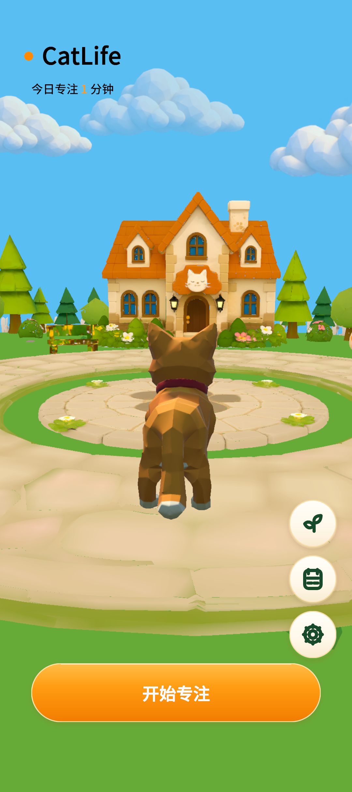
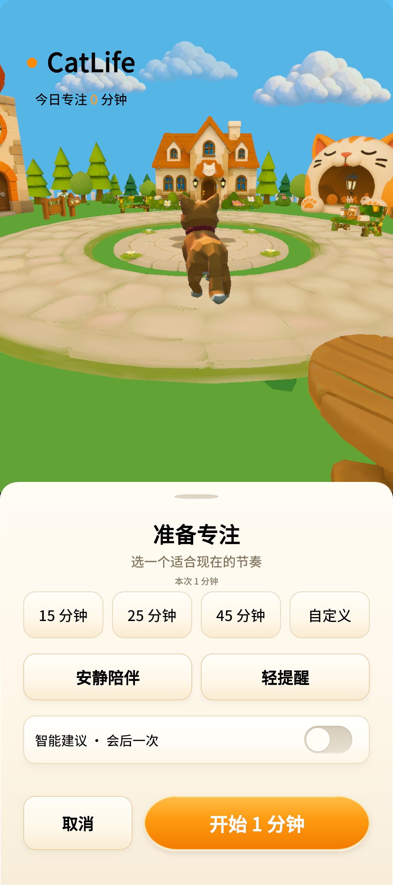
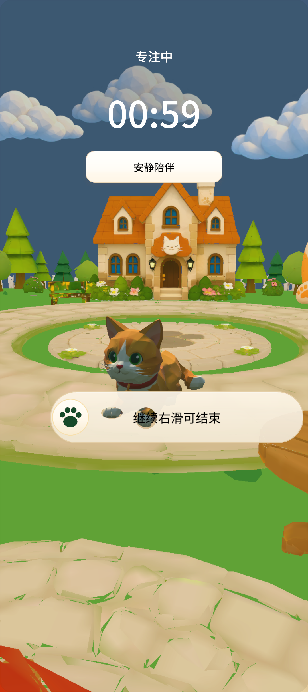

# CatLife

**和一只猫，在低多边形小镇里开始一段专注。**

Unity · Android · 3D 猫咪陪伴 · 会后 AI 建议

[实际画面](#实际画面) · [核心体验](#核心体验) · [技术实现](#技术实现) · [验证与进展](#验证与进展) · [工程入口](#工程入口)

CatLife 是面向学习与备考场景的猫咪陪伴式专注应用。选择时长后，猫咪走到位置、趴下陪伴；完成专注获得成长与爪印，并可选择接收一次 AI 会后建议。希望通过小镇与猫咪的亲和反馈，降低开始学习和回到学习的阻力。

项目起源于中国高校计算机大赛 AIGC 创新赛。当前处于 Android 模拟器候选验证阶段，持续收口核心体验。

## 实际画面

以下均为 **2026-10-24 Android 模拟器直接截图**，不是 AI 生成的设计预览。主页来自 r33，准备与专注来自 r34；截图仅展示对应时刻。

<table>
  <tr>
    <th>主页 · r33</th>
    <th>准备 · r34</th>
    <th>专注 · r34</th>
  </tr>
  <tr>
    <td></td>
    <td></td>
    <td></td>
  </tr>
</table>

## 核心体验

**领取与命名 → 准备 → 行走到位 → 趴卧陪伴 → 专注 → 奖励 → 记录与成长**

| 能力 | 当前实现 |
|---|---|
| 猫咪陪伴 | 小镇巡游、站立、趴卧、呼吸、起身及互动动作；使用专门调整的模型与动画 |
| 专注会话 | 15 / 25 / 45 分钟及自定义 1–180 分钟，安静陪伴与轻提醒 |
| 温和退出 | 滑条、猫咪挽留与退出确认，保留用户结束权；中断不发成长与爪印 |
| 记录与成长 | 本地会话、今日与七日统计、成长和爪印、动作解锁 |
| 设置与隐私 | 默认时长、行为统计开关、AI 同意与开关、本地数据清除 |
| AI 会后反馈 | 经同意后发送本次会话聚合数据，生成简体中文短建议，并映射到本地允许且已解锁的猫咪反应 |

核心计时、记录与奖励在本地运行。AI 仅承担可选的会后反馈：**不决定倒计时、不修改奖励、不直接生成骨骼动画**。未经同意不请求，每会话最多请求一次；云端反馈有独立的来源标识。

上述为已接入能力概览；不同候选的验证范围见下方记录，尚未完成最终同包全量验收。

## 技术实现

| 层次 | 实现 |
|---|---|
| 客户端 | Unity 6000.4.9f1、C#、Android ARM64、序列化 uGUI |
| 会话与存档 | 唯一 Session 状态源，本地目标时间恢复、会话记录与派生统计 |
| 猫咪表现 | 导航负责位移与朝向，动作控制器协调行走、站立、趴卧、起身和反馈 |
| 美术管线 | Blender 派生母版 → FBX / 运行贴图 → Unity；原始素材独立保留 |
| AI 接入 | OpenAI 兼容接口、MiMo 系列模型；会后单次请求及本地动作白名单 |

会话状态控制 UI、镜头与猫咪表现；AI 返回结果通过本地映射呈现，保持会话逻辑与云端生成分离。

小镇运行资产保留完整空岛、建筑和贴图，当前预算为 **229,286 三角面、16 个材质、167 个稳定资产 ID**。不通过删除岛底或小镇背景换取包体下降。

## 验证与进展

最近候选：**r34 · 2026-10-24 · 0.3.0 / version code 3 · APK 84.12 MiB**，低于 120 MiB 目标。

- r34 相关 PlayMode **3 / 3** 通过，覆盖自主巡游、选路与执行路径一致、准备到专注链路。
- 模拟器完成两段各 150 秒巡游录制及普通 1 分钟自然完成流程；奖励成长 +1、爪印 +1，冷启读回记录。
- 完整视频解码并读取 682 张关键原帧，用于检查连续状态与移动表现。
- 较早候选已取得真实 MiMo 会后响应，并以 12 个合成聚合场景评估建议；**r34 本次为离线验证，不能据此认定最终同包云端验收通过**。

详见 [r34 修复与模拟器验证记录](08-handoff-docs/planning/CatLife_r34最终落点选路修复_20261024.md)。局部测试和模拟器记录不代表全部功能、真机性能或真实用户效果通过。

### 仍在收口

- Reward 统计区域信息缺失、黑带，以及 Focus 结束条遮挡猫爪。
- 最终候选的完整功能、恢复、AI 来源与可见动作统一回归。
- 运行源码与资产依赖的交付整理；当前巡游仍有慢大回转，作为已知表现问题保留。
- Android 10+ / 4GB 真机、真实用户研究及公开渠道发布尚未完成。

## 工程入口

| 目录 / 文件 | 内容 |
|---|---|
| [work/CatLife_Unity_Main](work/CatLife_Unity_Main) | 当前 Unity 工程 |
| [07-tech-specs](07-tech-specs) | UI、会话和技术规格 |
| [08-handoff-docs/planning](08-handoff-docs/planning) | 阶段计划、缺陷与实际验证记录 |
| [02-asset-specs](02-asset-specs) | 美术需求与资产规范 |
| [06-deliverables](06-deliverables) | 历史比赛交付与阶段资料；概念稿不等于运行效果 |

开发入口：使用 Unity Hub 以 **6000.4.9f1** 打开 `work/CatLife_Unity_Main`，Android 构建需要对应的 Android Build Support。Blender 用于源模型与动作制作，不作为 APK 运行依赖。

原始大模型、派生二进制和部分运行资产在本地独立维护，当前仓库尚未整理为克隆即可完整构建的发行源码包。AI 凭据不进入仓库；本页不提供含本地凭据的 APK 下载。

---

更新于 2026-10-26。交付展示以本仓库主页为准，功能和质量结论以对应版本的实际验证记录为准。
